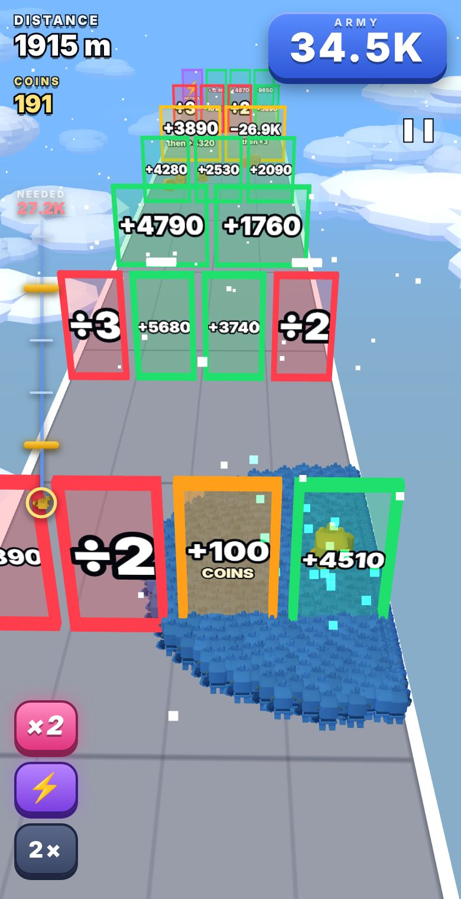
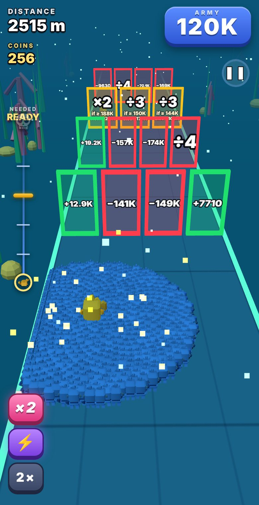

<p align="center"></p>

# Gate Rush: Multiply & Conquer

An infinite gate-math runner / crowd shooter. Slide your army left and right through +, −, ×, ÷ gates,
split lanes, time-pressure gates, and titan and boss fights. TypeScript + three.js, bundled with esbuild.

**Play it:** https://carterkeel.github.io/gate_rush/

## Screenshots

<p align="center">
  
  
  
  
  
  
  
</p>

## Controls
Drag or swipe, or use A / D or the arrow keys. The 2× button (bottom left) doubles your run speed. Pause with the ❚❚ button, Esc or P (it also pauses when you switch tabs). The first "Play" runs a short tutorial; Settings has a controls guide and a button to replay it.

## Android app
Every push to `main` builds an APK with GitHub Actions (Capacitor). Download `gate-rush.apk` from the [apk-latest release](https://github.com/carterkeel/gate_rush/releases/tag/apk-latest). It is the same game, fullscreen with a little extra top margin for camera cutouts and without the keyboard hints.

## Develop
```
npm install
npm run build       # bundles to dist/index.html and docs/index.html (the GitHub Pages site)
npm run typecheck
npm run sim         # fairness simulation of the gate and fight generators
npm run test:numbers
```

Project layout:

| Path | What it is |
|---|---|
| `index.template.html` | Page markup (menus, HUD). `build.mjs` inlines the CSS and the JS bundle into it. |
| `src/styles.css` | All styles, in cascade order (later sections refine earlier ones). |
| `src/main.ts` → `src/game.ts` | Entry point and the game loop: run state, spawning, gate crossing, fights, scoring. |
| `src/ui.ts` | Every DOM screen and HUD element. Per-frame setters only write to the DOM when a value changes. |
| `src/track.ts`, `gateGen*.ts`, `fightGen.ts`, `combatModel.ts` | Level generation and fight balancing (pure, seeded, covered by `npm run sim`). |
| `src/enemies.ts`, `army.ts`, `world.ts`, `gateView.ts`, `coins.ts`, `fx.ts` | three.js scene objects. |
| `src/storage.ts`, `audio.ts`, `dev.ts`, `config.ts` | Save data, generated sound, hidden dev menu, tuning constants. |

## Gold
Gold is earned by distance, by picking up the spinning coins laid between gate sets, and by playing the best gate. They buy skins, trails and upgrades.

## Bonus gates and power-ups
Rarely, one gate in a set pays something other than army: **+100 gold**, an **instakill** that wipes out the next fight (enemies, titans and bosses), or a saved **×2 army**. Taking one costs you that set's army growth, so it is a real choice.

When a run ends, your **largest army** is converted into a bonus: 1 gold per million units, shown as a stack of units turning into gold.

## Upgrades
Bought with gold on the Upgrades screen: **Double Speed** (1000 gold) unlocks the 2× button, and **Head Start** (15 levels, 100 m up to 800 m, each level costs about 30 % more) lets a run begin further along with an army sized for that distance. A head start does not add to score or coins; only what you run and the army you grow beyond the gift count.

## Sound
All sound effects and the music loop are synthesised with the Web Audio API (no audio files). Music and sound-effect volume have separate sliders under Settings (on the main menu and the pause screen); the choice is stored under `gate-rush-audio`.

## Models
Characters (Footman, Orc Warband and the red orc enemies) and weapons are Kenney's CC0 "Mini Dungeon" models, baked into static vertex-coloured geometry (`tools/bake.py`, `tools/build_models.py`, output in `src/modelData.ts`). See `THIRD_PARTY_NOTICES.md`.

## Save data
Gold, skins, trails, high scores and the tutorial flag are stored in the browser's `localStorage`
under the key `gate-rush-save-v1`. They stay on that device and browser; clearing site data resets them.

## Notes
`docs/index.html` is the built game. Rebuild and commit it after source changes.

## License
MIT License (see `LICENSE`): free to use, copy, modify and sell, as long as the copyright notice stays with it. Bundled third-party parts (three.js, Kenney models, Android libraries) keep their own notices in `THIRD_PARTY_NOTICES.md`.
