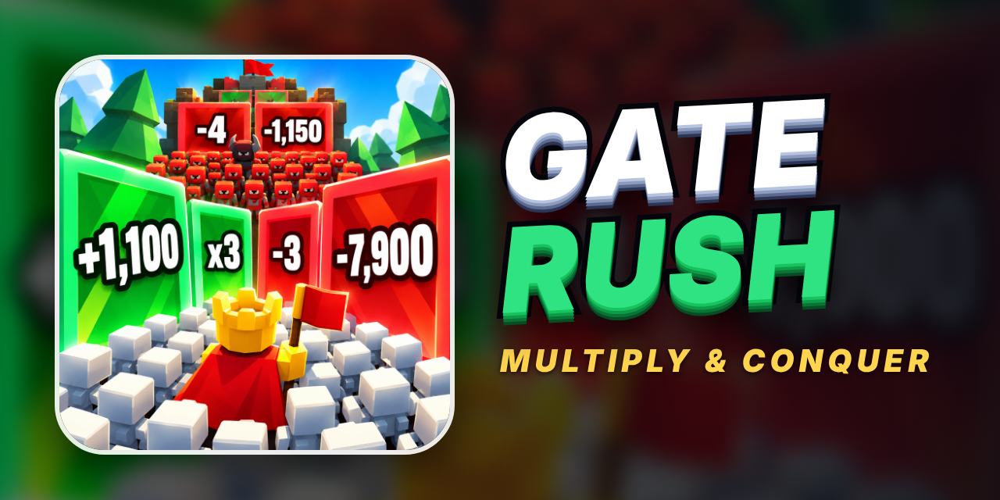
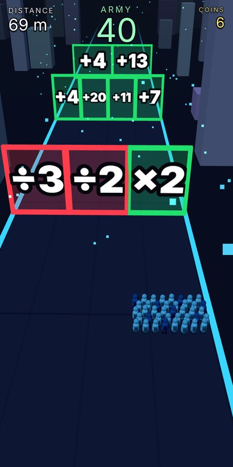
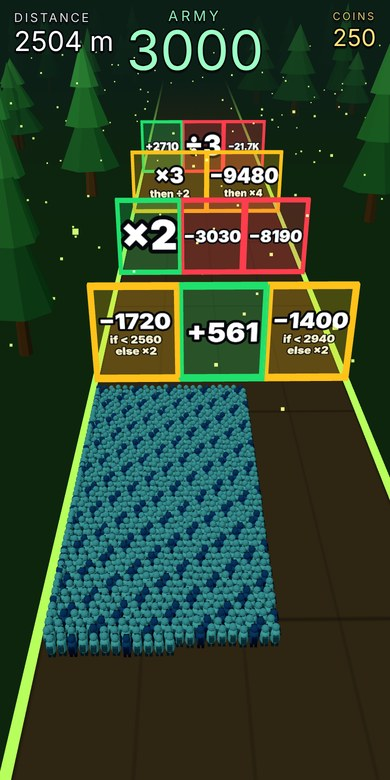
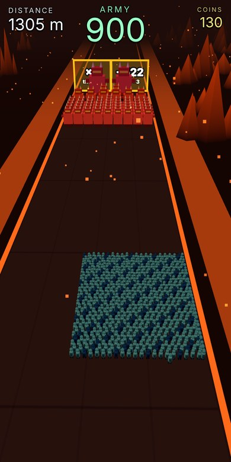
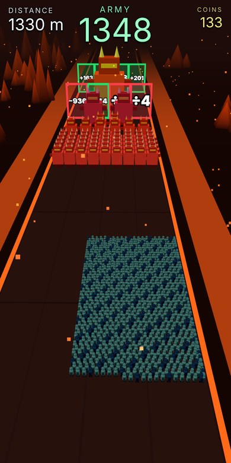

<p align="center"></p>

# Gate Rush

An infinite gate-math runner / crowd shooter. Slide your army left and right through +, −, ×, ÷ gates,
split lanes, time-pressure gates, and titan and boss fights. TypeScript + three.js, bundled with esbuild.

**Play it:** https://carterkeel.github.io/gate_rush/

## Screenshots

<p align="center">
  
  
  
  
  
</p>

## Controls
Drag or swipe, or use A / D or the arrow keys. The first "Play" runs a short tutorial; "How to play" replays it.

## Develop
```
npm install
npm run build       # bundles to dist/index.html and docs/index.html (the GitHub Pages site)
npm run typecheck
npm run sim         # fairness simulation of the gate and fight generators
```

## Save data
Coins, skins, trails, high scores and the tutorial flag are stored in the browser's `localStorage`
under the key `gate-rush-save-v1`. They stay on that device and browser; clearing site data resets them.

## Notes
`docs/index.html` is the built game. Rebuild and commit it after source changes.
